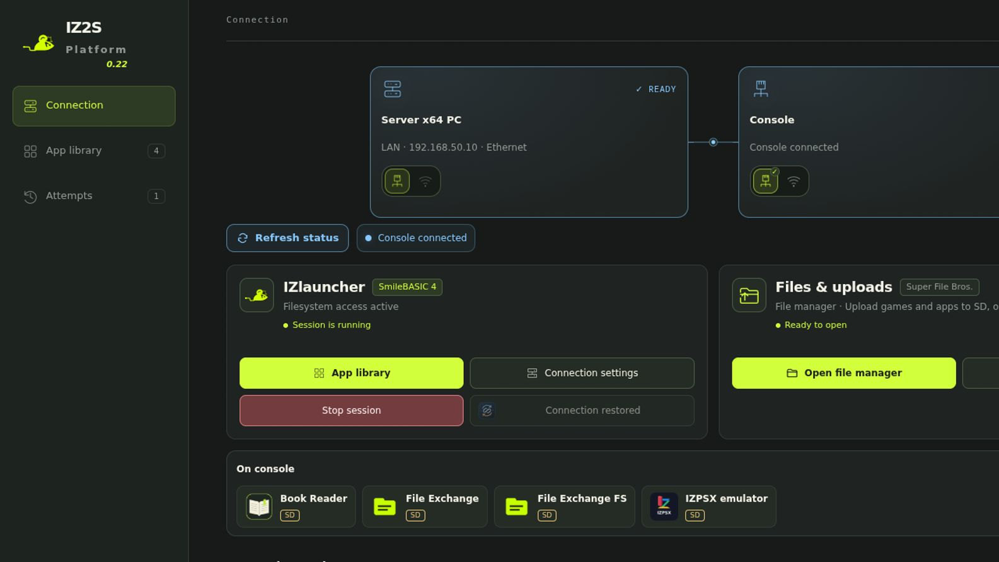
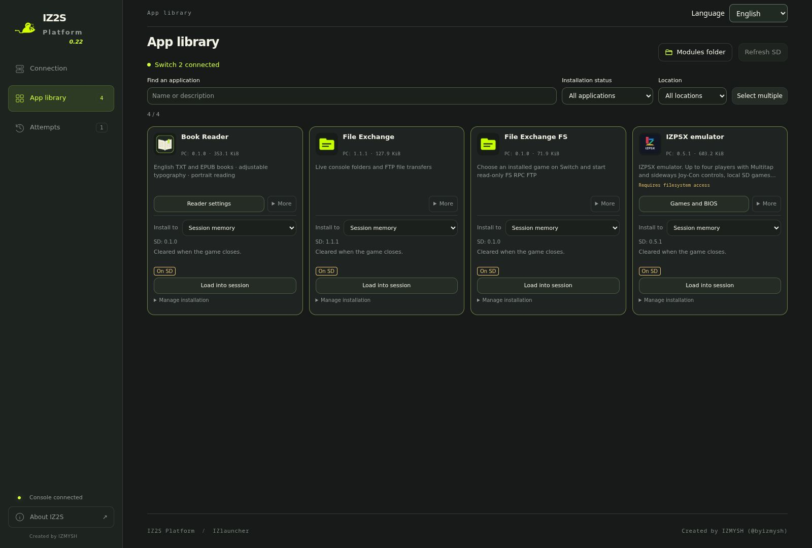
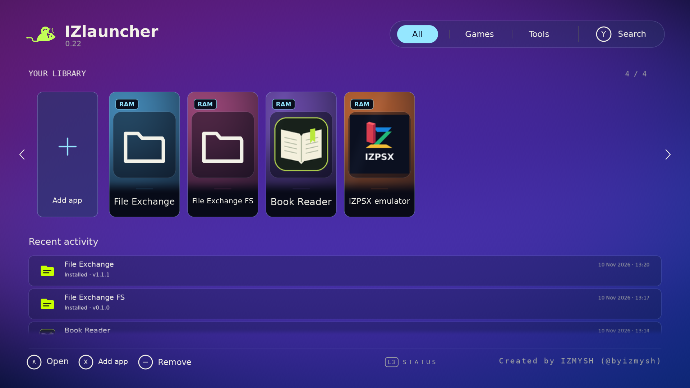
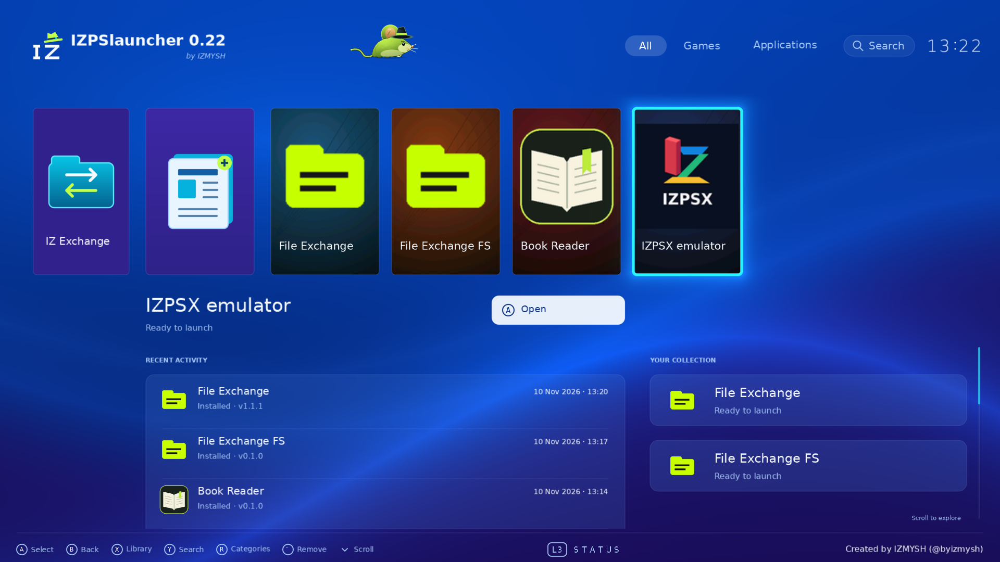

# IZ2S Platform

IZ2S Platform runs a control panel on your PC and manages a SmileBASIC connection to Switch 2. **IZlauncher** and **IZPSlauncher** are the two console menu styles. **IZ2S Core** is the default connection engine; IZMYSH is the developer credit.

Support for **Civilization VII** and **Balatro** will be added within a week after the developer receives physical copies.

[Recommended setup](#recommended-console-setup) · [Installation](#install-with-one-entry-file) · [Offline use and sleep](#offline-use-and-console-sleep) · [Screenshots](#screenshots) · [Additional modules](#modules-for-iz2s-platform) · [FAQ](FAQ.md) · [Compatibility](COMPATIBILITY.md) · [Changes since 0.16](RELEASE-NOTES.md) · [Support](SUPPORT.md)

## Offline use and console sleep

**Both IZlauncher and IZPSlauncher support offline use after the initial launch from the PC.** The loaded console menu and supported local content can continue when the PC connection is lost. Internet access is not needed for installed local content.

**You can put Switch 2 to sleep with the launcher open and resume after waking it**, as long as SmileBASIC and its native session remain running. First Setup does not need to be repeated after sleep.

Starting or switching modules through the PC, returning from host-managed applications, FS access and streaming still need the PC connection; online services also need internet access. A lost PC connection is not restored automatically. See the [offline and sleep FAQ](FAQ.md#offline-use-and-console-sleep) for recovery details.

## Screenshots

### PC control panel

| Connection | App library |
| --- | --- |
| [](docs/images/connection.png) | [](docs/images/app-library.png) |
| Choose the console menu, connection engine, input device and network. | Browse modules, open their settings and choose what to load on the console. |

### Console menus

| IZlauncher | IZPSlauncher |
| --- | --- |
| [](docs/images/izlauncher.png) | [](docs/images/izpslauncher.png) |
| Console menu with an application library and module details. | Alternative console menu with horizontal application navigation. |

## Recommended console setup

Prepare this configuration **before installation and First Setup**:

- **Use handheld mode for FS access.** Start with this mode when acquiring the FS endpoint.
- **Use a wired LAN connection for FS access**, with the PC and console on the same local network. Keep the chosen USB keyboard input device connected as required by its setup guide.
- **Restrict the console's internet access while preserving local communication.** Use [SWFence](https://github.com/byizmysh/SWFence) on a compatible OpenWrt router for a LAN-only policy, or [90DNS](https://gitlab.com/a/90dns) for Nintendo-domain filtering. **90DNS does not block all internet traffic.** See the [network preparation FAQ](FAQ.md#recommended-console-and-network-setup).

**If FS acquisition repeatedly fails:** stop the session and fully restart Switch 2. Open any installed game for about **10 seconds**, close it completely, then open **SmileBASIC 4 → Direct** and try Launch again. This is a recovery workaround, not a guaranteed fix; never retry over a failed session with retained native resources. See the [FS recovery steps](FAQ.md#what-if-fs-acquisition-keeps-failing).

## Install with one entry file

Extract the **whole** prepared archive into a writable local folder. Do not run an entry file from inside a ZIP or move it away from the other files. Open the entry file for your OS:

| Computer | Installation | Later launches |
| --- | --- | --- |
| Linux x64 / ARM64 | Open `Install-Linux.desktop`, allow launching if your desktop requests it | IZ2S Platform application shortcut or `start.sh` |
| Windows x64 | Double-click `Install.cmd` | Start-menu shortcut or the installed `Start.cmd` |
| macOS Intel / Apple silicon | Double-click `Install.command` | `~/Applications/IZ2S Platform.app` or the installed `Start.command` |

Linux installs missing packages through apt, pacman or dnf and may ask for administrator approval. If your desktop will not execute the installer, run `sh install.sh --launch` in its folder. Windows/macOS prepare private Node.js 24, Python 3.12 and Pillow automatically; no npm, Homebrew, Xcode or system Python installation is needed. Windows uses its OpenSSH client or downloads a private portable client for ARM input. The installers create a new per-user installation, add a shortcut and request panel startup. They do not install an ARM-board OS, flash ADV or launch a console session.

Windows may show a downloaded-file warning; organization policy can require administrator approval. On macOS, review the specific file in **System Settings → Privacy & Security → Open Anyway** if offered. If a `.command` file lost execute permission, run `chmod +x Install.command Start.command` in its extracted folder. Installation needs internet access and a writable user profile. See the [installation FAQ](FAQ.md#installation-and-os-prompts) for permission and network recovery, including package-manager prompts on Linux.

**Windows/macOS installers are experimental and still require testing on those operating systems. Native console sessions remain enabled only for the declared Linux hosts.** Successful installation or opening the browser does not establish full console compatibility. See the [compatibility table](COMPATIBILITY.md) and [OS-specific FAQ](FAQ.md#installation-and-os-prompts).

Node.js 24 currently requires Windows 10 or later on x64 and macOS 13.5 or later; Windows targets x64; macOS targets Intel x64 and Apple silicon ARM64. These are runtime minimums, not an IZ2S qualification claim. See the [Node.js platform requirements](https://github.com/nodejs/node/blob/v24.x/BUILDING.md#platform-list).

## What is included

| Component | Purpose |
| --- | --- |
| [IZlauncher](shells/izlauncher) / [IZPSlauncher](shells/izpslauncher) 0.21 | Two console menu styles |
| [IZ2S Core](engines/izmysh/README.md) | Default connection engine; developer IZMYSH |
| [ns2jb by BermTheSequel](engines/BermTheSequel) | Bundled alternative |
| [ARM PC](hardware/agents/arm-input/README.md) / [Cardputer ADV](hardware/devices/cardputer-adv/README.txt) | Alternative network-controlled USB keyboard input devices |
| [Super File Bros.](https://github.com/byizmysh/super-file-bros) | Integrated FS browser with optional external file-manager launch |
| [File Exchange](modules/iz-exchange/README.md) / [File Exchange FS](modules/iz-exchange-fs/README.md) | Title-owned files and retained FS RPC exports |
| [Book Reader](modules/BookReader/README.md) | TXT/unencrypted EPUB reader and library settings |

[Super File Bros.](https://github.com/byizmysh/super-file-bros) remains a separate standalone project.

## Modules for IZ2S Platform

Extend IZ2S Platform with these separately installed modules:

| Module | What it does | Get it |
| --- | --- | --- |
| **[BlitBun](https://github.com/byizmysh/BlitBun)** | Stream a PC application's video and audio to Switch 2, with live resolution changes, separate Dock/Handheld profiles and optional forwarding of controllers paired with the console. | [Download and install](https://github.com/byizmysh/BlitBun/releases/latest) |
| **[VacooTube](https://github.com/byizmysh/VacooTube)** | A YouTube player for Switch 2 with touch and controller navigation. Browsing, search, playback and settings are controlled from the console after setup; the application runs on the PC in the background. Includes its own bundled BlitBun streaming engine. | [Download and install](https://github.com/byizmysh/VacooTube/releases/latest) |

Install IZ2S Platform first, then follow the chosen module's README. Both modules include their PC and console components and can be installed independently: neither requires the other. They are optional downloads and are not bundled with the platform installer. Check each module's own host OS and dependency requirements.

[Emulators and other modules](modules/README.md#additional-modules) are also separate packages; installing the platform does not install their host dependencies.

## Connect the console

1. Choose a launcher, engine and input device. The current console profile targets Switch 2 system 23.0.1 and SmileBASIC 4.4.9; check compatibility before using other versions.
2. Follow **First Setup** to enter and save the selected BASIC program. An upgrade from 0.16 requires this again: the old `NS2I` program is not the current `NS2IZM` bootstrap; renaming the file is insufficient.
3. Fully restart Switch 2, open fresh SmileBASIC Direct and follow **Launch**. After a failed or ended native session, restart the console before another attempt.
4. Enable **FS endpoint (--rpc)** before Launch when you need retained FS access. Super File Bros. opens as an IZ2S tab; choose an external file manager there separately.

### ARM PC input

The separate Linux board needs SSH and a working USB keyboard gadget. First Setup deploys the supplied `packages/iz2s-arm-input.tar.gz`; it does not install or repair the board OS. A compatible input API 1 installation does not need replacing for every launcher update. See the [ARM instructions](hardware/agents/arm-input/README.md).

### Cardputer ADV input

1. Follow the firmware step in First Setup using M5Launcher USB storage, or choose **File** to download the package and copy it manually.
2. Launch the IZ2S-ADV firmware and select the same local Wi-Fi network as the PC. Enter its password with the ADV keyboard; **Tab** shows or hides it.
3. Enter the IP shown on ADV in Device settings if the local `iz2s-adv.local` hostname is unavailable. A plain IP address is accepted.
4. Move ADV's USB **data cable from the PC to Switch 2**. The panel detects USB readiness automatically over Wi-Fi; no manual USB checkbox is needed.

Firmware **0.21.3** can reannounce an unconfigured USB keyboard after a console restart while the panel is checking its status. It leaves active input and configured USB sleep alone, and never replays commands. See the [ADV connection and recovery guide](hardware/devices/cardputer-adv/README.txt).

Text and keyboard actions are preloaded onto ADV; the PC requests local actions over Wi-Fi. Match the panel's Caps Lock setting to SmileBASIC for correct capitalization. See the [firmware/Wi-Fi/USB instructions](hardware/devices/cardputer-adv/README.txt).

## Modules and files

Closing a module tab closes its view. Use **Stop** in the sidebar or **Stop module** to stop the module. Its view can be reopened quickly. Console-session Stop is separate.

An offline session is retained rather than automatically relaunched. After ending it, or after a failure with uncertain native cleanup, restart the console before starting a new native session.

The shared SD location is `SD:/IZ2S/Homebrew/Modules/<module.id>/`. Opening **SD & console storage** prepares folders for installed modules. Module authors adopt this path explicitly through `context.sdStorage`; old files are not moved automatically. See the [SDK storage contract](sdk/SD-STORAGE.md).

FTP exports are read-only. Browser SD operations provide explicit upload, rename and deletion controls; internal console filesystems remain read-only. Windows Explorer and macOS Finder do not provide a general writable view of FS RPC; see the [FAQ](FAQ.md) for their FTP limits. [Book Reader](modules/BookReader/README.md) libraries/settings stay local and are not included in public archives.

File Exchange's `/save`, `/tmp` and `/rom` belong to the SmileBASIC title; they are separate from general SD storage and installed-game exports.

## Build and local testing

A developer build additionally needs glslangValidator, spirv-val and Python/Pillow. Runtime users use the prepared shaders and bundled fonts; no shader compiler is required.

```sh
node distribution/verify.cjs
python3 distribution/release.py --rebuild
```

Local installer/SD regression scripts are kept in the working tree; the prepared public package excludes tests. The [local verification record](distribution/LOCAL-CHECKS.md) and [manual acceptance plan](distribution/HOST-TESTING.md) remain included. Documentation, scripts and default UI text use English; translations are kept in the four interface catalogs.

The builder works in a temporary copy and produces a Linux tar.gz, a source ZIP and explicitly experimental Windows/macOS ZIPs in `dist/github/`. All contain the complete installation files; the Windows/macOS names do not claim a qualified native console host. Private `data/`, keys, downloaded runtimes, books, logs, tests and session snapshots are excluded. Building does not upload anything. The repository destination is [byizmysh/IZ2S-Platform](https://github.com/byizmysh/IZ2S-Platform).

## License

Preserve [COPYRIGHT](COPYRIGHT), [LICENSE-SCOPE.md](LICENSE-SCOPE.md), [THIRD_PARTY.json](THIRD_PARTY.json) and component notices. Independently authored project code is GPL-2.0-or-later; this does not grant missing upstream permissions. See [Support](SUPPORT.md) for the limits of local and physical-device verification.
