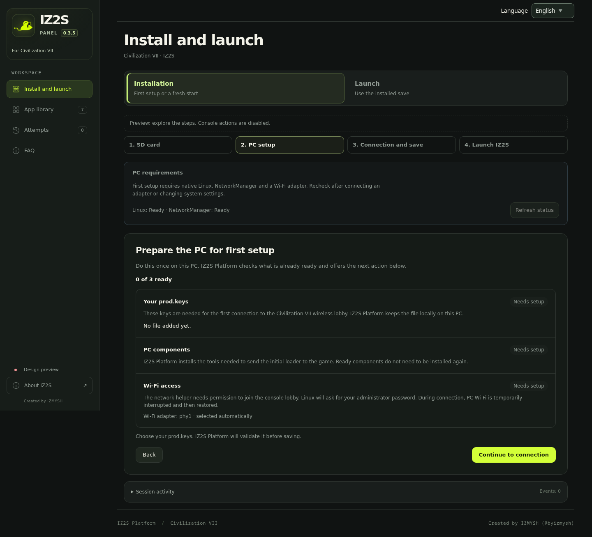

# IZ2S

[Russian](README.ru.md) · [Installation](docs/INSTALLATION.md) · [FAQ](FAQ.md) · [Compatibility](COMPATIBILITY.md)

FAQ: [English](FAQ.md) · [Russian](FAQ.ru.md) · [Simplified Chinese](FAQ.zh.md) · [Spanish](FAQ.es.md)

IZ2S combines a PC setup panel and a console application launcher for **Nintendo Switch 2**, using **Civilization VII** as the entry point. This edition is dedicated to Civilization VII. The SmileBASIC 4 edition and its input-device setup are now maintained in the separate [IZ2S-SB4 repository](https://github.com/byizmysh/IZ2S-SB4).

The panel guides SD preparation, PC preparation, connection with automatic save installation, and launch. Once IZ2S is running, PC Link connects the application library and FTP provides file access.



## Release 0.3.5

Download **`IZ2S-0.3.5-linux.zip`** for Linux x64 or ARM64. It contains both the PC installer and the matching SD archive with the console launcher, four applications and their licenses.

0.3.5 adds deferred menu artwork, shader-content cache keys, safer GPU resource cleanup and on-demand NRO libraries. It also fixes the missing `send_js` dependency in the panel connection check. Both panel and launcher now display 0.3.5. See the [complete changes](RELEASE-NOTES.md).

## Requirements

- Nintendo Switch 2 with firmware **23.0.1**.
- The **Nintendo Switch 1 cartridge of Civilization VII, version 1.0.0**.
- A microSD card and card reader for the matching SD package.
- For the first wireless-lobby installation: native Linux x64 / ARM64, a compatible Wi-Fi radio and your own Switch 1 `prod.keys`. Windows and WSL do not provide this initial LDN step.
- Set the console interface to **English** and USB keyboard input to **English (US)** before starting Civilization VII. The exact settings paths are in the [installation guide](docs/INSTALLATION.md).

Firmware, game edition and version are specific requirements; this release does not claim compatibility with other combinations. No Nintendo keys, BIOS, game images or personal saves are included.

## Start the PC panel

Extract `IZ2S-0.3.5-linux.zip` on your PC and open the resulting `IZ2S-0.3.5-linux` folder. Run this command in that folder to install and open the panel:

```sh
sh ./install.sh --launch
```

The installer verifies the files, prepares dependencies, creates an application-menu shortcut and launches the panel. It prints the installed directory, normally under `~/.local/share/iz2s-platform/releases/`. Package installation may require your password. Later, use the **IZ2S 0.3.5** shortcut or run `./start.sh` in the installed folder.

The normal panel address is `http://127.0.0.1:39535/`. Use the URL opened or printed by the launcher, which includes local session authorization. Preview is available with `./preview.sh` or `node start.cjs --preview --no-open`; it opens a separate temporary port and disables console actions.

## Install and launch

1. **SD card:** find `iz2sciv-core-sd.zip` next to `install.sh` and extract its contents into the card root so you get `SD:/iz2s/`. If you need another copy, click **Download SD archive** in the panel. If updating older IZ2S, replace the matching files too. Keep the `Nintendo` folder, other applications, BIOS, games and saves. Safely eject the card.
2. **Prepare PC:** complete the dependency, key and Wi-Fi checks shown by the panel.
3. **Connect and install save:** reboot the console, select English, clear all Civilization VII saves for the selected profile if repeating the full procedure or switching from another loader, and create a fresh wireless lobby. Confirm readiness and press **Connect and install save** once. The panel restores PC Wi-Fi, checks the console loader and installs `IZ2SCIV.Civ7Save` automatically.
4. **Launch IZ2S:** return to HOME, close Civilization VII with **X**, reopen it and select **Load Game**. Do not reboot the console at this point. After `IZ2S CORE IS RUNNING`, close Civilization VII and hold **R** while opening a Switch 2 game. Repeat that R-held launch once if needed.

## Applications and controls

| Application | Version | Included in SD package |
| --- | --- | --- |
| [IZ2S Cheese](https://github.com/byizmysh/iz2s-cheese) | 0.8.7 | Yes |
| [IZPSX emulator](https://github.com/byizmysh/IZPSX-emulator) | 0.5.3 | Yes |
| [IZPS2 emulator](https://github.com/byizmysh/IZPS2-emulator) | 0.5.0 | Available separately in the PC library |
| [NX2 BreRUN](https://github.com/byizmysh/nx2-brerun) | 0.6.0 | Yes, full-screen NRO |
| [Foldrift](modules/Foldrift) | 0.3.3 | Yes |
| [Book Reader](modules/BookReader) | 0.1.0 | Available separately in the PC library |
| [BlitBun](https://github.com/byizmysh/BlitBun) | 1.15.8 | Available separately; PC media host requires Linux |

In the launcher, **A** opens the selected application and **X** opens Add app. **R + L3** toggles PC Link; **L + R3** toggles FTP. L3/R3 mean clicking the left/right stick. Enabling FTP on the console and connecting the panel's FTP client are separate states.

Use **R + Up** to select two Split-compatible IZA applications. Press **+ and -** together to open window controls. NX2 BreRUN and other NRO applications open full screen.

Application companions, manifests and license files must stay with their launchers. See [application storage and updates](docs/APPLICATIONS.md). The SD package contains only `iz2s/` and does not supply Nintendo keys, BIOS or games.

## Checks, source and support

- [Release notes](RELEASE-NOTES.md): Panel fixes, menu startup, graphics cleanup and NRO runtime changes.
- [Compatibility](COMPATIBILITY.md) lists the supported console and host configurations.
- [Build and verification](BUILDING.md): local checks, SD packaging and prepared installer archives.
- [Source scope](SOURCES.md): recorded provenance and remaining native rebuild limitations.
- [Support](SUPPORT.md): useful diagnostics without sharing private keys or session tokens.

Packaging checks on a PC do not prove a console launch. The full native runtime cannot currently be rebuilt from this checkout alone; see the source-scope statement before redistribution.

## Authors, upstream work and licenses


**IZMYSH (@byizmysh)** authors and maintains IZ2S integration and the application adaptations. This project relies on work by many other authors; renaming an interface does not remove their authorship or license terms.

- **BermTheSequel, pepsipu and kurumuz**: the ns2jb family and inherited console connection work. Exact retained origins/revisions are in the engine provenance and installer notices: [ns2jb2](https://gitlab.com/BermTheSequel/ns2jb2), [pepsipu/ns2jb](https://gitlab.com/pepsipu/ns2jb/), [kurumuz/ns2jb](https://gitlab.com/kurumuz/ns2jb).
- **ouncebrew and contributors**: kaiHEN, libkaihen, libounce and related runtime components. Original names and notices are preserved for attribution in `engines/iz2s-core/runtime/package/licenses/` and runtime provenance. [kaiHEN](https://github.com/ouncebrew/kaihen).
- **OunceVK, Mesa/NVK/Zink, devkitPro, switchbrew and their contributors**: graphics, native runtime and homebrew components. Individual component licenses apply; bundled texts include Mesa, libounce, libnx, nx-hbloader and nx-hbmenu.
- **Gezine**: the original [CivSwitch](https://github.com/Gezine/CivSwitch) and related MIT-licensed files. Original notices remain in `engines/iz2sciv-shared/LICENSE`, `engines/iz2sciv-network/LICENSES/` and `engines/iz2sciv-core/`.
- **ItsNerisma / Nerisma**: [CivSwitchLDN](https://github.com/ItsNerisma/CivSwitchLDN) (GPL-3.0) and [CivSwitchFS](https://github.com/ItsNerisma/CivSwitchFS) (MIT), the original Civilization VII LDN and filesystem work. **ave**: the [kaiHEN port](https://github.com/s8n/CivSwitchFS-kaiHEN). These authors are distinct from IZ2S's integration work.
- **Kinnay / Yannik Marchand**: the GPL-3.0 [LDN library](https://github.com/kinnay/LDN) and local-wireless protocol research used by CivSwitchLDN.
- **Slapah / Hokage, pepsipu, kurumuz, Alula, civswitch-kit and civ7-fs contributors**: filesystem porting, inherited runtime work and stability improvements acknowledged by CivSwitchFS. Its upstream acknowledgements also credit **epiccsolar** for independent kaiHEN work. Exact roles and retained notices are listed in [AUTHORS.md](AUTHORS.md).
- **misshexa66 and OunceCake contributors**: filesystem tooling. [OunceCake](https://github.com/misshexa66/OunceCake); original GPL notice retained in `core/filesystem/ouncecake/`.
- **hyln9 and nxhid contributors**: the Switch keyboard base. The older input-device integration is removed; its MIT, libnx and font notices remain under `LICENSES/historical-input-devices/`. [nxhid](https://github.com/hyln9/nxhid).
- **M5Stack, lovyan03, Benoit Blanchon, Ha Thach, Espressif and Arduino contributors**: Cardputer firmware dependencies, including M5Cardputer, M5Unified, M5GFX/LovyanGFX, ArduinoJson, TinyUSB, ESP-IDF, Arduino-ESP32 and IRremote. Historical notice texts remain under `LICENSES/historical-input-devices/`; the input-device firmware is excluded from this edition.
- **DejaVu/Bitstream font authors, Monocypher authors, GitHub Octicons authors**, and the authors of Terser, Acorn, source-map, jridgewell mapping libraries and buffer-from: typography, signature verification, artwork and runtime JavaScript processing. Original notices remain beside their components.
- **ARMSX2, PCSX2, PCSX-ReARMed and their contributors**, plus VIXL, cubeb, SoundTouch, libchdr, fmt, ImGui, libzip, cpuinfo, simpleini, rcheevos, discord-rpc, plutosvg and plutovg authors: inherited statically linked runtime code. IZPSX is included in the SD kit, and IZPS2 is available in the PC library; associated native dependency license texts are retained in `LICENSES/native-linked/`. Native source coverage is described in [SOURCES.md](SOURCES.md).
- **Electron/Chromium, Node.js, Python, uv, Pillow, OpenSSH, FFmpeg and audio-stack contributors**: bundled or separately installed host dependencies. Electron's complete third-party HTML notice is preserved in each bundled runtime. Downloaded tools retain their own license terms.

`LICENSE` and `COPYRIGHT` cover independently authored IZMYSH code under **GPL-2.0-or-later**. Explicit MIT components (including Foldrift and IZ2S Cheese), third-party code, fonts and prior grants retain their own licenses. This is not a blanket relicensing. See [LICENSE-SCOPE.md](LICENSE-SCOPE.md), [THIRD_PARTY.json](THIRD_PARTY.json), [AUTHORS.md](AUTHORS.md) and [LICENSES/INDEX.md](LICENSES/INDEX.md).

The native runtime contains additional previously linked components, whose notices remain applicable. Their notices must be preserved. See [SOURCES.md](SOURCES.md) for the scope of the available native sources and [COMPATIBILITY.md](COMPATIBILITY.md) for platform support.
