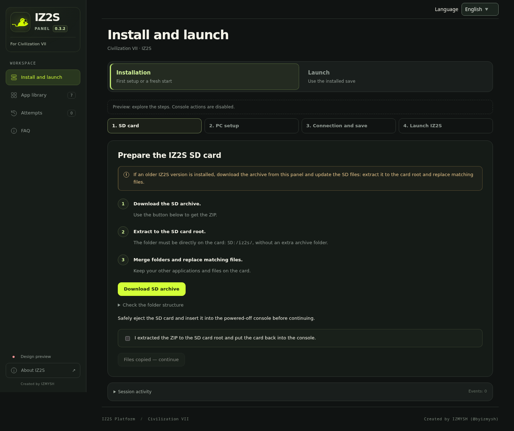

# IZ2S

[English](README.md) · [Установка по шагам](docs/INSTALLATION.ru.md) · [FAQ](FAQ.ru.md) · [Совместимость](COMPATIBILITY.md)

FAQ: [English](FAQ.md) · [Русский](FAQ.ru.md) · [简体中文](FAQ.zh.md) · [Español](FAQ.es.md)

IZ2S объединяет панель настройки на ПК и лаунчер приложений на Nintendo Switch 2. Эта сборка предназначена для входа через **Civilization VII**. Версия для SmileBASIC 4 и настройка устройств ввода теперь находятся в отдельном репозитории [IZ2S-SB4](https://github.com/byizmysh/IZ2S-SB4).



## Сборка 0.3.2

[Скачать IZ2S 0.3.2](https://github.com/byizmysh/IZ2S-Platform/releases/tag/v0.3.2). Эта версия предназначена **только для Linux** и включает согласованный SD-комплект для Civilization VII.

| Файл | Назначение |
| --- | --- |
| [IZ2S-0.3.2-linux.tar.gz](https://github.com/byizmysh/IZ2S-Platform/releases/download/v0.3.2/IZ2S-0.3.2-linux.tar.gz) | Linux x64 / ARM64, полная первоначальная установка |
| [iz2sciv-core-sd.zip](https://github.com/byizmysh/IZ2S-Platform/releases/download/v0.3.2/iz2sciv-core-sd.zip) | Согласованные файлы лаунчера, четыре приложения и лицензии для SD |

## Что потребуется

- **Nintendo Switch 2 с прошивкой 23.0.1**.
- **Картридж для Nintendo Switch 1 Civilization VII 1.0.0**.
- microSD и картридер.
- Для первоначального подключения через беспроводное лобби - настоящий Linux x64 / ARM64, подходящий Wi-Fi адаптер и собственный `prod.keys` со своей Switch 1. Windows и WSL этот этап не выполняют.
- Перед запуском игры - английский язык интерфейса консоли и английский язык USB-клавиатуры. Пути к обоим меню приведены в [инструкции](docs/INSTALLATION.ru.md).

Совместимость с другими прошивками, редакциями и версиями игры не заявлена. Ключи Nintendo, BIOS, игры и личные сохранения в комплект не входят.

## Запуск панели

Распакуйте полный установочный архив в новую папку.

**Linux:** откройте терминал в этой папке и выполните:

```sh
sh ./install.sh --launch
```

Установщик проверит файлы, подготовит зависимости, создаст системный ярлык и откроет панель. Для установки системных пакетов может понадобиться пароль. Путь к установленной копии будет выведен в терминале; обычно это новая папка внутри `~/.local/share/iz2s-platform/releases/`.

Далее используйте ярлык **IZ2S 0.3.2** или `./start.sh` из установленной папки.

Обычная панель работает на `http://127.0.0.1:39532/`; открывайте адрес, который выдал лаунчер вместе с авторизацией локального сеанса. `./preview.sh` или `node start.cjs --preview --no-open` запускает временный предпросмотр на отдельном порту: шаги можно изучать, действия с консолью отключены.

## Четыре шага установки

1. **SD-карта:** скачайте комплект в панели и распакуйте содержимое в корень SD. При обновлении старой IZ2S замените совпадающие файлы. Папку `Nintendo`, другие приложения, BIOS, игры и сохранения оставьте на месте. Безопасно извлеките карту.
2. **Подготовка ПК:** выполните проверки зависимостей, собственных ключей и Wi-Fi в панели.
3. **Подключение и сохранение:** перезагрузите консоль, выберите английский язык, при необходимости выполните очистку старой установки и создайте новое беспроводное лобби. Нажмите **«Подключить и установить сохранение»**. Панель восстановит Wi-Fi ПК, проверит загрузчик и сама установит `IZ2SCIV.Civ7Save`.
4. **Запуск IZ2S:** выйдите в HOME, кнопкой **X** закройте Civilization VII, снова откройте её и выберите **Load Game**. Консоль на этом этапе не перезагружайте. После `IZ2S CORE IS RUNNING` закройте игру и, удерживая **R**, откройте игру для Switch 2. При необходимости повторите этот запуск с R один раз.

## Приложения и связь

SD-комплект включает **IZ2S Cheese 0.8.7, IZPSX 0.5.3, IZPS2 0.5.0 и Foldrift 0.3.3**. Book Reader, BlitBun и VacooTube доступны отдельно в библиотеке ПК; медиасервисы BlitBun и VacooTube требуют Linux.

**A** запускает выбранное приложение; **X** открывает Add app. **R + L3** переключает PC Link, **L + R3** - FTP. L3/R3 - нажатия на левый/правый стик. Включённый FTP на консоли ещё не означает, что FTP-клиент панели подключён.

[Каталоги приложений и обновление](docs/APPLICATIONS.md) · [Изменения](RELEASE-NOTES.md) · [Проверки и сборка](BUILDING.md) · [Исходники](SOURCES.md) · [Поддержка](SUPPORT.md)

Проверка архивов на ПК и успешный запуск на консоли - разные результаты. Полная пересборка всего нативного окружения только из этого репозитория пока не обеспечена; ограничения описаны в SOURCES.md.

## Авторы и лицензии

**IZMYSH (@byizmysh)** поддерживает интеграцию IZ2S. Авторство исходных проектов, названия ABI и лицензии сохранены. Полный список: [AUTHORS.md](AUTHORS.md), [раздел авторов](README.md#authors-upstream-work-and-licenses), [LICENSES/INDEX.md](LICENSES/INDEX.md), [LICENSE-SCOPE.md](LICENSE-SCOPE.md).
