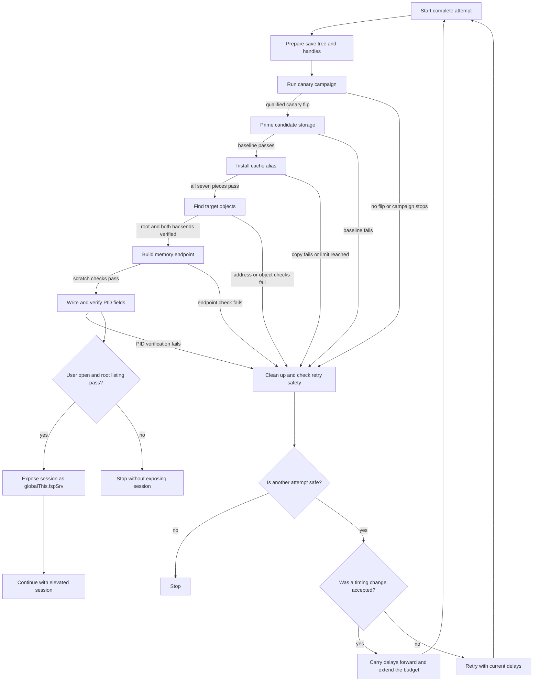
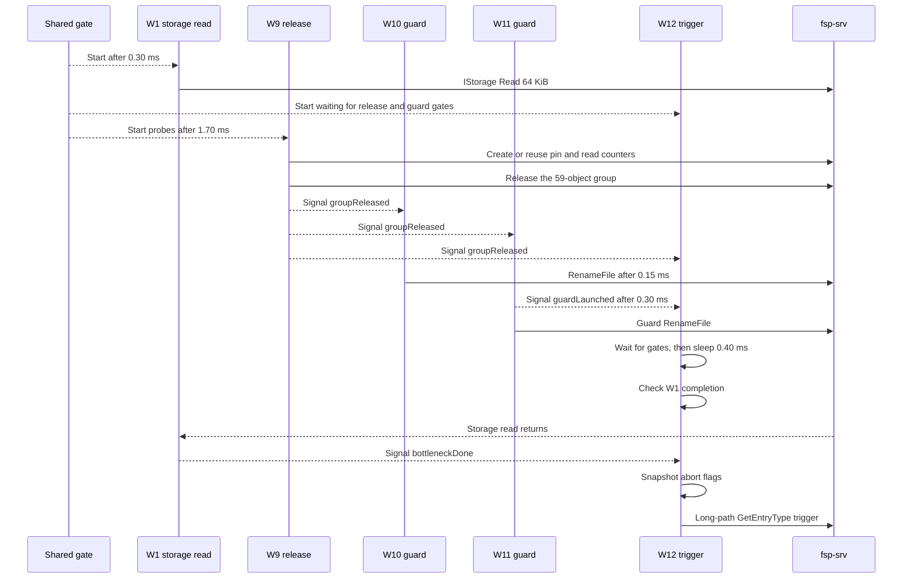
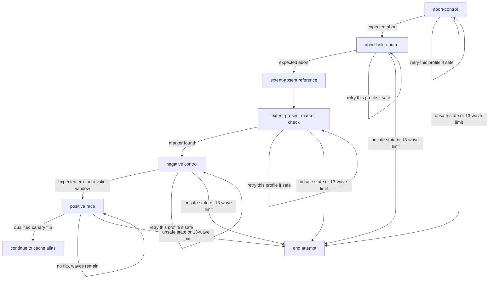
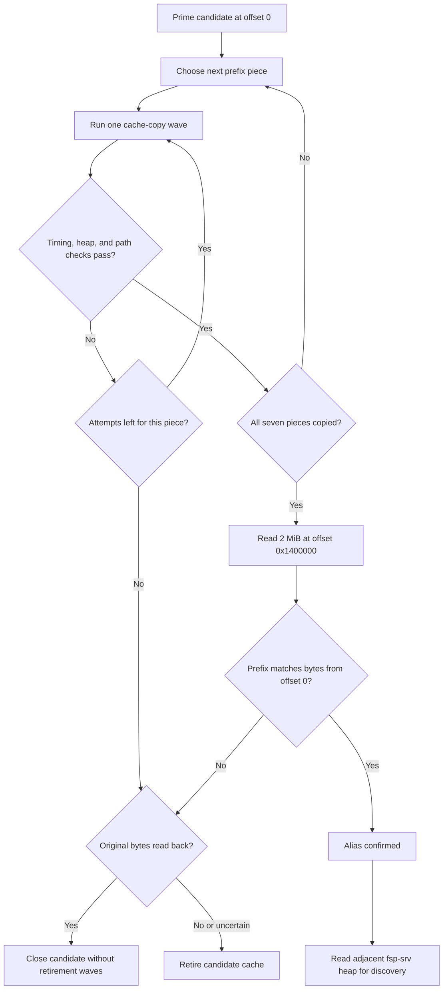
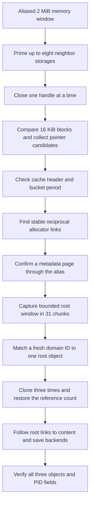
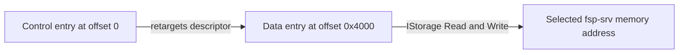

# How the exploit promotes an `fsp-srv` session

This document starts after the CivSwitch userland exploit launches its payload. It follows the payload from its initial `fsp-srv` session to verified User content-storage access.

When the exploit opens an `fsp-srv` session, `SetCurrentProcess` gives the service the game process ID from Horizon's IPC special header. Promotion does not change the game's identity. **It changes the PID fields that `fsp-srv` checks when granting filesystem access.**

## Contents

- [Why it works, in brief](#why-it-works-in-brief)
- [Overview](#overview)
- [1. Prepare and qualify the race](#1-prepare-and-qualify-the-race)
  - [Sessions and save tree](#sessions-and-save-tree)
  - [What happens in a wave](#what-happens-in-a-wave)
  - [Worker roles](#worker-roles)
  - [Reservations and persistent pin](#reservations-and-persistent-pin)
  - [Timing within a wave](#timing-within-a-wave)
  - [Canary profiles and retry logic](#canary-profiles-and-retry-logic)
- [2. Create the cache alias](#2-create-the-cache-alias)
  - [Prime candidate storage](#prime-candidate-storage)
  - [Copy the cache prefix](#copy-the-cache-prefix)
- [3. Find and verify the target objects](#3-find-and-verify-the-target-objects)
  - [Find pointers by releasing cache entries](#find-pointers-by-releasing-cache-entries)
  - [Qualify the address and metadata](#qualify-the-address-and-metadata)
  - [Map the root object and its backends](#map-the-root-object-and-its-backends)
- [4. Build a retained memory endpoint](#4-build-a-retained-memory-endpoint)
  - [Use separate control and data entries](#use-separate-control-and-data-entries)
  - [Stop the cache owner loop](#stop-the-cache-owner-loop)
- [5. Write the PID fields and prove access](#5-write-the-pid-fields-and-prove-access)
  - [Write and verify each object](#write-and-verify-each-object)
  - [Test User access and expose the session](#test-user-access-and-expose-the-session)

## Why it works, in brief

The exploit times a long-path `GetEntryType` lookup while a save commit and path-fragment requests are still in flight, just after the 59 reserved objects are released. A temporary file-to-directory change in the canary confirms that the race reached its intended state.

**The cache entry's offset no longer matches the bytes it holds.** The exploit tags a primed content-storage entry for offset `0x1400000` while keeping the bytes read from offset `0`. A widened `IStorage::Read` returns those known bytes, then reaches adjacent `fsp-srv` heap. This alias gives discovery a memory view to find the root filesystem object, the NCA (Nintendo Content Archive), and the save backend.

Each of those three objects stores a PID that `fsp-srv` checks for filesystem permissions. The retained endpoint writes PID `1` into each field. Opening User content storage and listing `/` then prove that `fsp-srv` accepts the promoted identity.

## Overview

The exploit first qualifies the filesystem race. It then creates a cache alias, finds the root filesystem object and its content and save backends, and sets the stored PID in all three objects to `1`.

Requests through the promoted session use those PID fields for filesystem permission checks. The exploit exposes the session as `globalThis.fspSrv` only after the User-content check passes.

The outer loop starts with 10 complete attempts. Each accepted timing adjustment can add one attempt, up to **30**.

> [!NOTE]
> A retry starts only after cleanup confirms that workers have stopped, temporary allocations are freed, the candidate cache is verified safe or retired, and `/hole` is gone. If cleanup cannot prove the state is safe, the exploit stops instead of carrying that state into another race.

## 1. Prepare and qualify the race

**The exploit creates the race by overlapping `fsp-srv` requests around a heap change.** One worker frees the reservation group while other requests are still in flight. Another sends the long-path `GetEntryType` lookup before they finish, and a third checks whether the canary briefly changes from a file to a directory. **One timed run of this arrangement is a wave.**

### Sessions and save tree

The loader has already mounted the save filesystem. `CopyFromCurrentDomain` gives the exploit an ordinary handle to its root object.

`CloneCurrentObject` creates more handles to that same filesystem. Each concurrent worker gets its own handle, so requests can run **independently** while changes to the shared files remain visible to every worker.

The first handle creates the scratch tree and canary. A second creates the marker path for the extent checks.

Wave workers use their own clones. W12 uses the marker handle for the extent profiles.

The scratch tree makes each profile's effect visible and repeatable:

- `commit_data` is an 8 MiB file. Before every wave, the exploit rewrites it with nonzero bytes so W0's save `Commit` has work to do.
- `canary` is a one-byte file at the end of a 1,440-character path (`0x5A0`). W6 checks its type around the trigger.
- `selected` is the directory in the positive trigger path.
- `SPAN_MARKER` sits at the end of a nested path. The extent profiles compare that path with the marker absent and present.

An empty-path request gives the abort checks a known error result to compare. Setup also requires `/hole` to be absent and enough free space for the scratch files.

Most requests use an ordinary `fsp-srv` session. Reservations use a domain session because `cmd 1200` returns object IDs that only that session can address. Each wave gets a fresh domain session so its reservation IDs stay scoped to that wave.

The final session also stays in domain form so later payloads can use its handle and root object ID to send commands and clone objects.

> [!NOTE]
> Domain mode lets `fsp-srv` address objects by ID. The PID fields control which filesystem permission checks pass. The final session needs both.

### What happens in a wave

Each wave starts 13 worker threads behind a shared gate. When the gate opens, each worker waits its assigned delay and runs its IPC work. The campaign repeats waves to see whether the schedule produces the required timing pattern and filesystem result.

The trigger is W12's `GetEntryType` request with a very long path. W2 through W5 carry the path fragments used by that lookup. W1 sends a 64 KiB content-storage read through an `IStorage` handle.

The exploit measures when each request starts and returns. These client-side spans show how requests overlap from the game's point of view, not the order in which `fsp-srv` executes them.

### Worker roles

The table adds a short role name to each worker ID.

| Worker | Request | Role in the race |
|---|---|---|
| W0 (commit) | Save `Commit` | Holds the 8 MiB save commit open across the trigger, adding save work to the overlap. |
| W1 (bottleneck) | 64 KiB `IStorage::Read` | Keeps W12 waiting and sets the measured completion boundary. |
| W2-W5 (fragments) | Four fragment requests (`cmd 1002`) | Carry the rest of the long path used by W12. |
| W6 (canary check) | `GetEntryType` for the canary | Samples the canary during the trigger. A temporary directory result is the race signal. |
| W7-W8 (fillers) | Filler `RenameFile` requests | Keep two other paths in flight, then let the post-wave check detect unexpected changes. |
| W9 (pin and release) | Pin, allocation probes, reservation close | Keeps the cache allocation alive, measures heap use, frees the reservation group, then signals the guards and trigger. |
| W10-W11 (guards) | Guard `RenameFile` requests | Run after release. W11 samples W1's completion flag and signals W12. |
| W12 (trigger) | Long-path `GetEntryType` | Waits for the gates, checks the abort flags, then performs the lookup. |

All 13 workers use the same selected core. The core argument to `svcCreateThread` sets an ideal core, which still allows the scheduler to run a thread elsewhere when its affinity mask permits it. Before starting any worker, the exploit calls `svcSetThreadCoreMask` with a mask containing only that core. If any call fails, it closes the unstarted workers and abandons the wave.

The worker priorities start at a value borrowed from a live game thread, then increase by each worker's index. Horizon gives smaller numbers higher priority, so W0 has the highest priority in this group and W12 the lowest. The single-core affinity makes those priority differences apply to the workers on the same scheduler. Priorities order runnable threads; they do not control the order in which `fsp-srv` processes requests.

**The requests have different overlap requirements:**

- W0 and W2-W5 must remain in flight for W12's entire lookup. This keeps the save commit and all path fragments active while the trigger runs.
- W6-W8 and W10-W11 must already be in flight when W12 starts. W6 can sample the canary during the lookup, the filler paths act as controls, and W11's guard signal lets W12 continue.
- W9 has a separate release check because freeing the reservation group is the heap change the race is trying to line up with those requests.

W1 is the **bottleneck** because W12 waits for its read to complete before sending the trigger. For the wave to qualify, W11's request must start while W1 is still running. **The 300 microsecond floor is a pass threshold, not a wait required by `GetEntryType`.** W1 must remain pending for at least that long after W11 starts. A shorter overlap is too narrow to count as a receive window. When retuning, the campaign aims for 500 microseconds to leave extra slack.

### Reservations and persistent pin

Before each wave, `cmd 1200` creates **59 service-domain objects**. They are separate from the 13 workers.

The 59 objects **create a known heap shape**. W9 frees them while the other requests are still running, so the heap change happens during the filesystem race.

Each object should account for 208 bytes, or 12,272 bytes total. Allocation counters verify the group before the wave. **If the total differs, later heap comparisons would use the wrong starting point,** so the exploit discards the group.

The exploit closes a bad group and retries with a fresh domain session, up to three times. After validation, it wraps the 59 IDs in one outer domain object. W9 can release the whole group by closing that object.

On the first wave, W9 opens the persistent pin with `cmd 200` and keeps the returned storage handle open. The handle keeps its cache allocation alive across later waves, so freeing the reservations does not also remove the allocation the race is measuring.

For the Civ VII target profile, the pin must account for exactly 6,960 bytes and its measured lifetime must fit inside the canary request. Heap checks use that exact allocation as their reference. Later waves reuse the same handle and allow 192 bytes of counter jitter.

> [!NOTE]
> The race needs two things at once: W9 must free the 59-object group, while the pin keeps the target cache allocation alive. A qualified flip means W6 saw a directory during W12, then the post-wave check saw the canary file again.

### Timing within a wave

Each worker starts after its configured delay. The delays and priorities serve different purposes: the delay controls when a role becomes eligible, while priority helps order workers that are ready on the shared core.

- W0 through W9: `0, 300, 350, 450, 550, 650, 1000, 1200, 1300, 1700` microseconds after the shared gate, in worker order.
- W10 and W11: 150 and 300 microseconds after W9 signals that the reservation group has been freed.
- W12: waits for the release and guard signals without an initial delay. After another 400 microseconds, it checks whether W1 has finished. If W1 is still running, W12 waits on its completion gate. It snapshots the abort flags before sending the trigger.

These defaults are in [`src/core/config.mjs`](src/core/config.mjs). The canary campaign may adjust the W0 through W9 delays and both guard delays, then carry an accepted schedule into the next full attempt.

The arrows show order, not scale. After its 400 microsecond sleep, W12 waits for W1 only if the read is still running. Otherwise, the completion gate is already signaled and W12 continues.

### Canary profiles and retry logic

One canary campaign has a shared budget of 13 waves. It runs control profiles first, so the exploit can check the abort gates and long-path requests before treating a canary change as success.

| Profile | What it checks | Expected result |
|---|---|---|
| `abort-control` | Starts with the completion flag set, testing W12's abort gate. | Saved abort result, canary remains a file. |
| `abort-hole-control` | Pre-sets W1's finished flag to simulate an early completion and test W12's abort checks. | Saved abort result, canary remains a file. |
| `extent-absent` | Sends the long path ending in the missing name `SPAN_ABSENT`. | Reference for a path whose final component is absent. |
| `extent-present` | Sends the same path shape ending in the existing `SPAN_MARKER` file. | W12 finds the marker, canary remains a file. |
| `negative` | Uses a path expected to return an error, while checking the timing window. | Error `0x2EEC02`, canary remains a file. |
| `positive` | Runs the long path that names the existing `selected` directory while W6 samples the canary. | A qualified canary flip, with all other paths unchanged. |

The abort, extent-present, negative, and positive profiles retry until their result is qualified or the attempt must stop. `extent-absent` runs once as a reference. **All profiles share the same 13-wave budget.** An unsafe state or an exhausted budget ends the attempt. The outer retry loop can start another attempt after cleanup proves that state safe.

The absent and present path profiles check that W12 receives the end of its long path, not just the first fragment. The negative control then confirms the ordinary path-error response. Only after those controls pass does the positive profile try to flip the canary.

**A positive wave counts as a valid window only when:**

- All 13 workers finish and join. The reservation group releases, and the IPC requests return their expected results.
- The pin and heap checks pass, at least `0x2600` cache bytes remain allocated before release, and no abort flag is set.
- All 10 overlap spans match the pattern described above, including the 300 microsecond W11-to-W1 margin.

The campaign qualifies a canary flip only when W6 sees the canary as a directory during the positive trigger, no other path changes, and a post-wave check sees the canary as a file again.

**Timing adjustments use repeated evidence:**

- If positive waves ran, the campaign considers a change only when fewer than half qualify. If none ran, it needs at least two extent-present or negative control samples, with fewer than half qualifying.
- The samples must point to one dominant timing issue. Positive-wave samples must fail on timing alone. Control samples may also fail other checks. A tie leaves the schedule unchanged.
- The campaign applies the median correction to one start delay. It ignores changes under 75 microseconds, caps a single change at 250 microseconds, and limits total drift to 1 millisecond. Neighboring starts must stay at least 50 microseconds apart.

An accepted schedule applies to the next full attempt. If the evidence does not support a change, the next safe attempt keeps the current delays.

> [!NOTE]
> The controls rule out broken setup before the race is counted. W12 must honor its abort gates, find the marker at the end of the long path, and return the expected missing-path error. Only then can a canary flip count as success.

Setup and wave scheduling live in [`setup.mjs`](src/core/steps/setup.mjs), [`campaign.mjs`](src/core/steps/campaign.mjs), and [`orchestration.js`](src/core/wave/orchestration.js).

## 2. Create the cache alias

To find the three PID bearing objects, the exploit needs to inspect memory owned by `fsp-srv`. A normal content-storage read returns file data, so the exploit rewrites a candidate cache entry to make a read at one offset return bytes primed at another.

**The alias is the memory-reading path used by discovery.** It lets the exploit inspect the nearby `fsp-srv` heap through an ordinary `IStorage::Read`.

The exploit builds it with the same worker schedule as the canary race, using a separate retry loop for the cache-copy waves.

### Prime candidate storage

First, the 16 bytes at offset `0` must differ from the 16 bytes at offset `0x1400000` (20 MiB).

A second content-storage handle reads offset `0` to create a separate cache entry. Its first 16 bytes must match the original read.

Those 16 bytes give discovery a known value to find in memory. If either baseline check fails, a later match at the alias offset proves nothing.

### Copy the cache prefix

**The prefix is 18 bytes:**

- The little-endian target offset `0x1400000`.
- Eight `A` bytes.
- A dirty flag set to `1`, telling the cache the entry has changed.
- A trailing NUL.

The `cmd 1002` path copy stops at a NUL byte. `nulWrites` builds seven prefixes, replacing earlier zero bytes with `B` so each prefix can be sent as a path.

Each of the seven prefixes gets up to 90 attempts, in three batches of 30. **A prefix passes only when the wave qualifies, at least `0x2810` cache bytes remain allocated before release, and no unexpected path changes.**

**Discovery starts with a 2 MiB read at offset `0x1400000`.** Its first bytes must match the values primed at offset `0`.

**If alias installation was attempted, cleanup checks the candidate read at offset `0x1400000` before launching retirement waves.** If it returns the original bytes, cleanup verifies that the alias is inactive and closes the candidate without the extra waves. If it returns the primed alias bytes, unexpected data, or a read error, cleanup runs the retirement path; an incomplete copy still leaves the mapping uncertain.

> [!NOTE]
> **The cache entry is tagged for offset 20 MiB but holds bytes primed at offset 0.** A widened read exposes the mismatch, then crosses the 16 KiB cache block into nearby `fsp-srv` memory. Discovery uses that memory window to find the objects it needs to promote.

PID writes use the retained endpoint described in section 4. See [`alias.mjs`](src/core/steps/alias.mjs).

## 3. Find and verify the target objects

**Each check narrows the search.** Releasing cache entries points to candidate addresses. Cache and allocator metadata confirm a memory region. A domain object ID then identifies the live root filesystem object and its backends.

### Find pointers by releasing cache entries

To find cache entries in the alias, the exploit opens up to eight extra content-storage handles. It primes each with sixteen 16-byte reads, one at the start of every 16 KiB cache block. Their entries should then appear in the memory window.

Next, it captures a 2 MiB baseline and closes the extra handles one at a time. After each close, it reads the window again and compares 16 KiB blocks. A link that changes with one handle's release points to that handle's cache data or owner. The read buffer starts filled with `0xA5`, so untouched bytes mark the end of valid data.

**A changed link is only a lead.** Its alignment and surrounding bytes must also fit the expected cache layout.

### Qualify the address and metadata

For each candidate, discovery builds a bounded read plan. The candidate pointer must sit in the expected cache-header field, and the alias must still return its known prefix. Cache buckets must repeat at `0x28000` intervals. Discovery then scans the bounded region for allocator links and possible metadata pools.

**A pool qualifies only when its links stay stable and point back to each other.** Discovery reads the metadata page twice through the alias and checks that both copies match the candidate layout. A normal storage read at the same offset must return different bytes. That comparison confirms the alias is showing memory rather than file contents.

**This scan does not write to filesystem objects.**

### Map the root object and its backends

The exploit reads a bounded `0x4D8000` window in 31 chunks of `0x28000` bytes. It searches for domain wrappers, which connect session object IDs to filesystem objects, and for the cache array and its owner.

A fresh domain session supplies a root object ID. The exploit checks the session's domain table bounds and capacity, then looks up the ID.

**Exactly one root filesystem object must match the expected wrapper layout.** The exploit clones it three times, checks that its reference count rises by three, then closes the clones. The full object must return to its original snapshot. **That increase and exact restoration confirm discovery found a live object and its reference-count field.**

From the root, discovery follows pointers to the NCA (Nintendo Content Archive) and save backends. Stable rereads check each object's layout, links, pointers, and PID field.

| Object | Stored PID field offset |
|---|---:|
| Root filesystem object | `+0x30` |
| NCA backend object | `+0x20` |
| Save backend object | `+0x28` |

> [!NOTE]
> **The root is only the entry point.** It routes content and save work to separate backends. Updating only the root leaves those backends with the old identity, so all three PID fields must match for both paths to work.

Discovery and scanning are in [`discovery.mjs`](src/core/steps/discovery.mjs) and [`scan.mjs`](src/core/helpers/scan.mjs).

## 4. Build a retained memory endpoint

**The discovery alias provides a broad memory window, but PID promotion needs exact reads and writes.** The exploit keeps the candidate storage and a verified cache array open, then retargets one data entry to each target address. That live read/write route is the retained endpoint.

### Use separate control and data entries

The endpoint uses two cache entries in one array. **The control entry at offset `0` holds the descriptors**, the metadata that says what each cache entry points to. The data entry at `0x4000` points to the selected address. A control write changes that pointer. An ordinary `IStorage::Read` or `IStorage::Write` at `0x4000` transfers the bytes.

Before using the endpoint on a target object, the exploit retargets the descriptor and reads the pointer back. It then tests both directions on scratch bytes: read a marker, write a second marker, verify the change through the control entry, and restore the original bytes. **Each `IStorage` request transfers at most 16 KiB.**

### Stop the cache owner loop

A background cache loop could process the synthetic descriptors during a transfer. **The exploit sets the owner's iteration count from 10 to 0 and checks that the other fields stay unchanged.** It repeats the scratch test after the loop stops.

> [!NOTE]
> **The alias finds the objects, the endpoint changes their PID fields.** Stopping the owner loop keeps background work from processing the repurposed descriptors during a transfer.

Endpoint construction and promotion live in [`promotion.mjs`](src/core/promotion.mjs).

## 5. Write the PID fields and prove access

### Write and verify each object

The exploit follows the same four checks for each object:

1. **Confirm the snapshot and object range.** Reread the full object, check that it still matches discovery, reject overlapping ranges, and skip the write if the PID is already `1`.
2. **Retarget the data entry.** Add the PID offset to the object address, point the descriptor there, and read the pointer back.
3. **Write PID `1`.** Send the little-endian 64-bit value through the data entry.
4. **Verify the whole object.** Reread it and accept the write only if the PID is `1` and every other byte matches the expected snapshot.

After all three writes, reread all three objects. **Each PID must be `1`, and every other byte must still match.**

### Test User access and expose the session

To test the promoted identity, the exploit calls `OpenContentStorageFileSystem(User=1)` (command `110`). The reply must contain exactly one filesystem object. It clones that object and lists `/`. **The open passes the `CanMountContentStorage` permission check, and listing `/` proves the returned filesystem works.** ([Switchbrew documents command 110 and its permission mapping](https://switchbrew.org/wiki/Filesystem_services#Permissions).)

After both checks pass, the exploit assigns the domain session to **`globalThis.fspSrv`**. The value contains the session handle and root object ID. Later payloads share the loader's JavaScript context and use it for more `fsp-srv` commands. The temporary User filesystem handle and domain object close. The promoted session stays open. The follow-up is in [`examples/user-storage.mjs`](examples/user-storage.mjs).

> [!NOTE]
> **A PID readback proves the write landed, not that the session can use the permission.** Opening User content storage and listing `/` prove `fsp-srv` accepts the promoted identity. The exploit publishes `globalThis.fspSrv` only after both checks pass.
