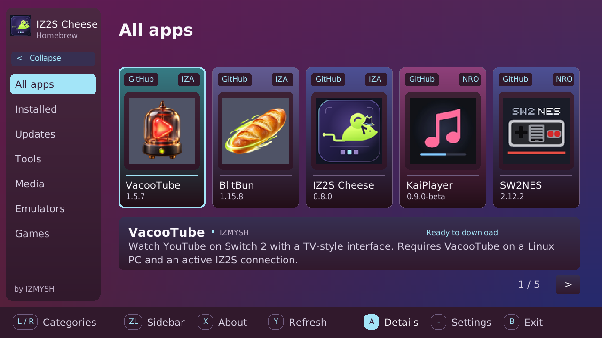
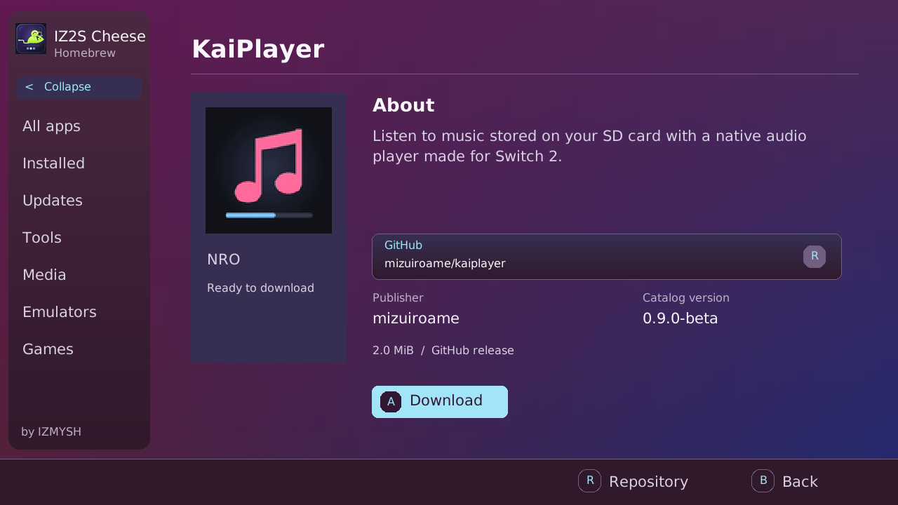

# IZ2S Cheese

A free homebrew hub for Nintendo Switch 2.

<p>
  <a href="screenshots/catalog.png"></a>
  <a href="screenshots/app-details.png"></a>
</p>

## Choose your build

| Console environment | Supported apps |
| --- | --- |
| [IZ2S](https://github.com/byizmysh/IZ2S-Platform) | **.iza** and **.nro** |
| [kaiHEN](https://github.com/ouncebrew/kaihen) | **.nro** |

## Install on IZ2S

> [!IMPORTANT]
> **Restrict the console's internet access before using online homebrew, while keeping local LAN access available for PC Link and FTP.** Configure and verify the restrictions before connecting the console to the internet.
>
> **Recommended on OpenWrt: [SWFence](https://github.com/byizmysh/SWFence).** Keep the console's general internet access blocked, preserve access to your selected local IPv4 network, and add only the GitHub destinations required by IZ2S Cheese as internet exceptions:
>
> ```text
> github.com
> api.github.com
> raw.githubusercontent.com
> release-assets.githubusercontent.com
> objects.githubusercontent.com
> ```
>
> These cover release links and the connection test, raw catalogs and thumbnails, release downloads, and supported download redirects. SWFence uses **exact domain names**: allowing `githubusercontent.com` alone does not allow its subdomains. Follow the SWFence setup and verification instructions; domain exceptions permit resolved destination IPs, which may be shared with other hosts.
>
> **Alternative: [90DNS](https://gitlab.com/a/90dns).** It filters Nintendo domains, but **does not block all internet traffic** and is not a GitHub-only firewall. Follow its console setup and testing instructions, including disabling IPv6 on Switch 2.

IZ2S Cheese runs from its own module. At startup, IZ2S Cheese checks that the launcher provides the functions it needs. Use an updated IZ2S Platform runtime and restart the IZ2S session after updating it.

- **From IZ2S Platform on PC.** Connect the console via PC Link, open **App library → Add app**, and select [`iz2s-cheese-install.iza`](https://github.com/byizmysh/iz2s-cheese/releases/latest/download/iz2s-cheese-install.iza). This single file includes the launcher, engine and interface assets. If the import is still queued, open **Add App** on the console.
- **From microSD.** Extract [`iz2s-cheese-iza-sd.zip`](https://github.com/byizmysh/iz2s-cheese/releases/latest/download/iz2s-cheese-iza-sd.zip) to the card root. Open the **IZ2S Cheese** tile.

IZ2S Cheese installs apps to `/iz2s/modules/<id>/launcher.iza` or `/iz2s/modules/<id>/launcher.nro`.

### Install on kaiHEN

Copy [`iz2s-cheese.nro`](https://github.com/byizmysh/iz2s-cheese/releases/latest/download/iz2s-cheese.nro) to `/switch/iz2s-cheese/iz2s-cheese.nro` or extract [`iz2s-cheese-nro-sd.zip`](https://github.com/byizmysh/iz2s-cheese/releases/latest/download/iz2s-cheese-nro-sd.zip) to the card root. Launch **IZ2S Cheese** from the homebrew menu. IZ2S Cheese installs apps to `/switch/<id>/<id>.nro`. IZA apps require IZ2S Platform.

## Browse apps and choose catalogs

On the main screen, press **A → Open community catalog** to browse the Switch 2 Homebrew Catalog. This uses the community [IZSTORE3 feed](https://raw.githubusercontent.com/dadadush/switch2-homebrew-catalog/main/catalog/catalog-new.tsv).

Press **ZR** or tap **Search** to find an app by name, publisher or catalog ID across enabled catalogs. Choose a sidebar category to narrow the results. Press **B** to clear the search. **ZL** switches between the full sidebar and the compact icon view.

Press **X → Catalogs** from the app list to manage sources. In Catalogs, **X** adds a URL, **A** toggles the selected source, and **Y** edits a custom URL. Cheese saves up to eight URLs, including the community catalog, plus the SD card source.

GitHub file links are converted to raw links. A repository link uses `main/catalog/catalog.tsv`. Cheese saves source addresses and enabled states on SD and carries over previously saved URLs when updating. A previous SD-only configuration keeps its saved URLs available in the list with their switches off.

Cheese combines enabled sources and reads thumbnails from `artwork.bin` alongside each TSV. Press **Y → Refresh** on the app list to update them. Each URL has its own offline cache. A failed refresh can still use that source's last valid copy.

Cheese shows one card per app ID. It prefers IZA on IZ2S and NRO on kaiHEN. If enabled catalogs offer the same build type, Cheese uses the first in the Catalogs list. The kaiHEN edition hides IZA-only apps.

For a local catalog, place `catalog.tsv` and `artwork.bin` in `/iz2s/modules/iz2s-cheese/catalog/` for IZA or `/switch/iz2s-cheese/catalog/` for NRO. Enable **SD card** under **Catalogs**. A local catalog already on the card is opened automatically on a clean start.

## Publish your own catalog

Create a separate public GitHub repository. Put `catalog.tsv` and `artwork.bin` at the root of the `main` branch. Open `catalog.tsv`, click **Raw**, and copy the URL into IZ2S Cheese.

See the [catalog format](docs/catalog-format.md) to list IZA releases and their companion files.

## Update IZ2S Cheese

Open **Settings → Check for Cheese updates**. Cheese checks the latest stable release directly on GitHub, independently of your catalog. If an update is available, its dialog offers **Update** and **Back**. Only the matching build is downloaded: IZA and its engine on IZ2S, or NRO on kaiHEN. Files are checked against GitHub's published SHA-256 digests before installation. The previous executable is kept; reopen Cheese after updating. This check uses `api.github.com`. Your saved catalog address and cache are preserved.

## Executables and dependencies

- **Cheese NRO:** the `.nro` contains the program, fonts and icons. The SD ZIP places it in the standard folder.
- **Cheese IZA:** the `iz2s-cheese-install.iza` installer contains `launcher.iza`, `sd-bundle.json` and the engine. App library installs those files together.
- **Other apps:** additional game data, BIOS, firmware or resources may be required as described by their authors. Catalog `file` rows can install IZA companion assets. Arbitrary folders, ZIP packages and NRO dependency trees are not supported by the current installer.

Both editions contain their own application code. IZA uses SDK services for networking, TLS, the system keyboard and threads. Catalogs and artwork are published separately.

See [building and native modules](docs/building.md) for SDK requirements and checks.
