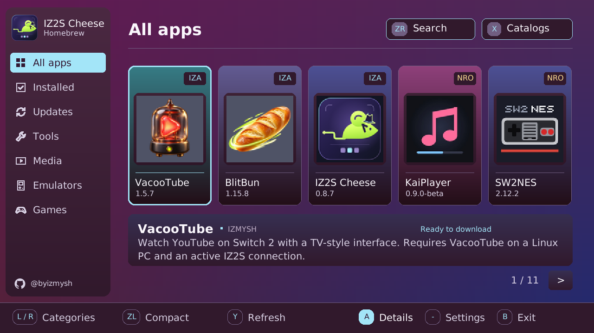
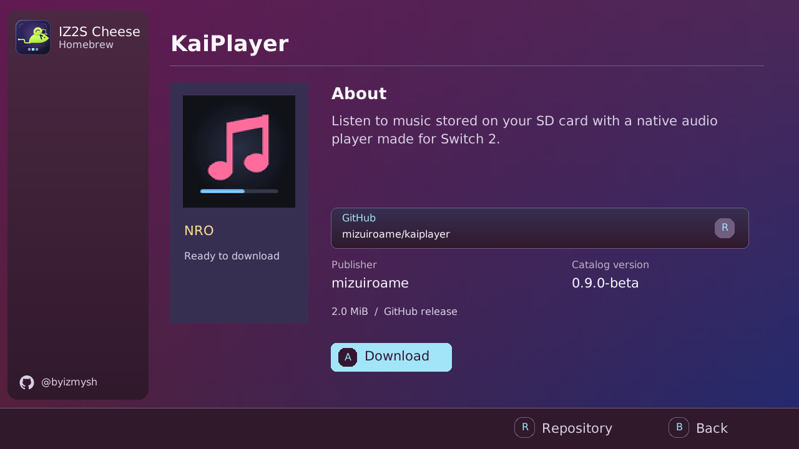

# IZ2S Cheese

A free homebrew hub for Nintendo Switch 2.

> [!IMPORTANT]
> **Restrict the console's internet access before using online homebrew, while keeping local LAN access available for PC Link and FTP.** Configure and verify the restrictions before connecting the console to the internet.
>
> **Recommended on OpenWrt: [SWFence](https://github.com/byizmysh/SWFence).** Keep the console's general internet access blocked, preserve access to your selected local IPv4 network, and add only the GitHub destinations required by IZ2S Cheese as internet exceptions:
>
> ```text
> github.com
> raw.githubusercontent.com
> release-assets.githubusercontent.com
> objects.githubusercontent.com
> ```
>
> These cover release links and the connection test, raw catalogs and thumbnails, release downloads, and supported download redirects. SWFence uses **exact domain names**: allowing `githubusercontent.com` alone does not allow its subdomains. Follow the SWFence setup and verification instructions; domain exceptions permit resolved destination IPs, which may be shared with other hosts.
>
> **Alternative: [90DNS](https://gitlab.com/a/90dns).** It filters Nintendo domains, but **does not block all internet traffic** and is not a GitHub-only firewall. Follow its console setup and testing instructions, including disabling IPv6 on Switch 2.

<p>
  <a href="screenshots/catalog.png"></a>
  <a href="screenshots/app-details.png"></a>
</p>

## Choose your build

| Console environment | Supported apps |
| --- | --- |
| [IZ2S](https://github.com/byizmysh/IZ2S-Platform) | **.iza** and **.nro** |
| [kaiHEN](https://github.com/ouncebrew/kaihen) | **.nro** |

## Install on IZ2S

IZ2S Cheese runs from its own module. Install the complete SD bundle so the executable and its engine are installed together. At startup, IZ2S Cheese checks that the launcher provides the functions it needs. Use an updated IZ2S Platform runtime and restart the IZ2S session after updating it.

- **From microSD.** Extract [`iz2s-cheese-iza-sd.zip`](https://github.com/byizmysh/iz2s-cheese/releases/latest/download/iz2s-cheese-iza-sd.zip) on your PC. Copy the extracted `iz2s/` folder to the root of the card. Keep `launcher.iza`, `sd-bundle.json` and its `asset-*.izdata` file together in `/iz2s/modules/iz2s-cheese/`. The executable alone is not a complete installation. Open the **IZ2S Cheese** tile.
- **From IZ2S Platform on PC.** Connect the console via PC Link, open **App library → Add app**, and select `iz2s-cheese-iza-sd.zip` directly. The panel imports the ZIP. If the import is still queued, open **Add App** on the console.

IZ2S Cheese installs apps to `/iz2s/modules/<id>/launcher.iza` or `/iz2s/modules/<id>/launcher.nro`.

### Install on kaiHEN

Extract [`iz2s-cheese-nro-sd.zip`](https://github.com/byizmysh/iz2s-cheese/releases/latest/download/iz2s-cheese-nro-sd.zip) to the card root or copy `iz2s-cheese.nro` to `/switch/iz2s-cheese/iz2s-cheese.nro`. Launch **IZ2S Cheese** from the homebrew menu. IZ2S Cheese installs apps to `/switch/<id>/<id>.nro`. IZA apps require IZ2S Platform.

## Add a catalog

Catalogs have **no fixed app-count limit**. Thumbnail images load on demand into a small cache. Install the current Store build before loading a catalog that exceeds an older build's limit.

The list is empty on first launch. Press **−**, select **Catalog URL**, and paste the raw URL of `catalog.tsv`.

IZ2S Cheese looks for `artwork.bin` alongside `catalog.tsv`. It saves the list and thumbnails to the card for offline browsing. Use **Settings → Download catalog** to refresh both files. IZ2S can download IZA and NRO apps from the same catalog. On kaiHEN, IZA entries are marked as requiring IZ2S.

For a local catalog, place `catalog.tsv` and `artwork.bin` in `/iz2s/modules/iz2s-cheese/catalog/` for IZA or `/switch/iz2s-cheese/catalog/` for NRO. Select **Settings → Catalog source → SD card**, then **Reload SD catalog**.

## Publish your own catalog

Create a separate public GitHub repository. Put `catalog.tsv` and `artwork.bin` at the root of the `main` branch. Open `catalog.tsv`, click **Raw**, and copy the URL into IZ2S Cheese.

See the [catalog format](docs/catalog-format.md) to list IZA releases and their companion files.

## Update IZ2S Cheese

Open **Settings → Cheese update**. The selected catalog must contain the official IZ2S Cheese release for your edition: IZA on IZ2S, NRO on kaiHEN. IZ2S Cheese verifies the downloaded files, keeps the previous executable and asks you to reopen the app. Rebuilt releases with the same version are detected by SHA-256.

Both editions contain their own application code. IZA uses SDK services for networking, TLS, the system keyboard and threads. Catalogs and artwork are published separately.

See [building and native modules](docs/building.md) for SDK requirements and checks.
