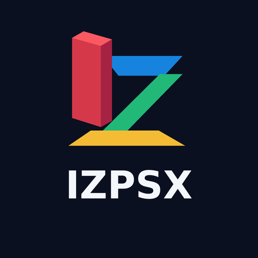
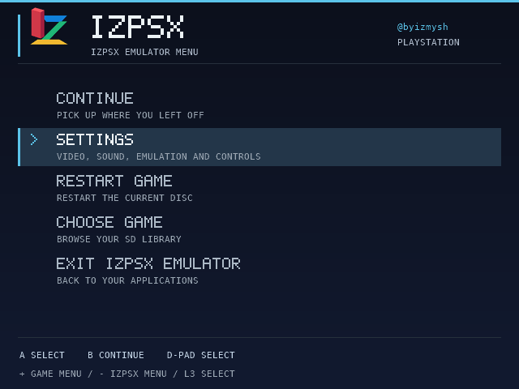
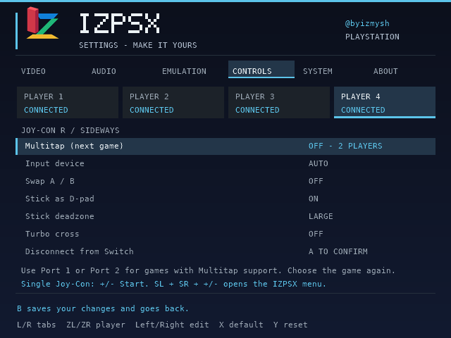

# IZPSX emulator

<p align="center"></p>

PlayStation emulation on **Switch 2**, with local ARM64 execution, an SD game library, persistent memory cards and controls for up to four players.

**IZPSX works only through [IZ2S Panel / IZ2S Platform](https://github.com/byizmysh/IZ2S-Platform). A working console connection with Filesystem access (FS) enabled and successfully acquired is required to install and use its games, BIOS, settings and saves.** Enable FS before starting the launcher and wait for the panel to confirm access. See the platform's [installation and launch guide](https://github.com/byizmysh/IZ2S-Platform#readme) and [FS troubleshooting FAQ](https://github.com/byizmysh/IZ2S-Platform/blob/main/FAQ.md).

[Install](#installation) · [Features](#what-makes-izpsx-useful) · [Screenshots](#screenshots) · [Controls](#controls) · [Files and saves](#storage-and-files) · [Build](BUILDING.md) · [FAQ](FAQ.md) · [Compatibility](COMPATIBILITY.md) · [License](LICENSE)

## Installation

**IZPSX emulator is already included in the latest [IZ2S Platform](https://github.com/byizmysh/IZ2S-Platform/releases/latest); no separate installation is needed.**

Download the module, SD package or complete corresponding source from [Releases](https://github.com/byizmysh/IZPSX-emulator/releases/latest). Each release includes `SHA256SUMS` for checking downloads.

1. Install [IZ2S Platform](https://github.com/byizmysh/IZ2S-Platform/releases/latest) with the compatible native launcher ABI. Its [README](https://github.com/byizmysh/IZ2S-Platform#readme) explains the SmileBASIC 4 and Civilization VII connection routes. This release targets Linux x64/ARM64 PC hosts.
2. Enable **Filesystem access** in the panel before launching. Wait until FS access is confirmed; an open browser tab alone does not mean that the console filesystem is available. If acquisition fails, follow the [platform FAQ](https://github.com/byizmysh/IZ2S-Platform/blob/main/FAQ.md) before another attempt.
3. In **App library**, add `izpsx-emulator-0.5.1.izm`, then choose **Session memory (RAM)** or **SD card**. The bundled platform release already includes IZPSX.
4. Open **IZPSX emulator → Games and BIOS → Connect SD card** in the panel. Provide your own 512 KiB `scph101.bin` BIOS and supported game dumps; neither is included.
5. Disconnect the file view when finished and open the IZPSX emulator tile on the console. **About** identifies whether the app was loaded from RAM or SD.

The separate SD ZIP is for an already initialized compatible IZ2S native launcher. Prefer the panel's App library so matching executable/assets, ownership and installation checks remain in force. Do not replace app or game files while the emulator is running.

## What makes IZPSX useful

- **Native emulation, RAM or SD.** The ARM64 core runs on the console. RAM loads the app for the current session; SD keeps it installed with its engine and data. Both use the same game, BIOS, settings and save folders.

- **Up to four players.** Each player has a device choice, A/B swap, stick-as-D-pad, deadzone and turbo Cross. Pro controllers, paired Joy-Con, handheld controls and sideways Joy-Con halves are supported. Choose Multitap on Port 1 or 2 for compatible games, then relaunch the game. Pair individual halves with SL/SR in HOME.

- **Picture and performance.** Display limits: Native, 20, 25, 30, 40, 50 or 60 FPS, with native emulation/audio timing preserved and separate EMU/VIDEO counters. Adjust aspect ratio, integer scaling, filtering, brightness, scanlines and overscan. A display cap does not fix slow emulation.

- **Audio and core settings.** Volume, mute, mono, buffering, SPU reverb/interpolation and CD music; dynarec/interpreter, PS1 CPU clock and Auto/NTSC/PAL timing. Options marked **next game launch** apply after selecting the game again.

- **Pause and return.** **Minus** opens Continue, Settings, Restart game, Choose game and Exit. **Plus = PS1 Start**; R3 has no exit shortcut. Video, audio and control changes apply on return to play. Pause and normal exit stop queued audio.

- **Persistent memory cards.** Two shared 128 KiB cards save to alternating verified generations, with flushing on pause/exit and recovery from a damaged latest copy. Settings use a separate journal. Keep backups; **save states are not implemented**.

- **Game-folder management.** Upload folders or CUE/BIN/IMG/PBP files, create directories and browse the library. The panel checks CUE tracks, paths and filename conflicts, adjusts the uploaded CUE copy and sends tracks first. It shares the platform's [Super File Bros. service](https://github.com/byizmysh/IZ2S-Platform/blob/main/tools/fs-rpc-browser/README.md). Transfers support cancellation and verified-checkpoint continuation where the session permits. Exit the running game before file operations.

## Screenshots

**Pause menu — continue, settings, restart, choose another game, or return to IZlauncher.**



**Controls — four independent player profiles.**



## Controls

In Controls, leave Player 1 → Device on **AUTO** to switch between attached handheld Joy-Con and the first external controller automatically. Attached controls take priority while available, even if a wireless Pro Controller stays connected. Explicit device choices remain fixed.

| Input | Action |
| --- | --- |
| A / B / D-pad | Select / back / navigate |
| Y in the library | Open the last played game |
| Plus (+) in a game | PS1 Start |
| Minus (-) | Emulator pause menu, or library settings |
| L3 / stick click | PS1 Select |
| L/R in settings | Change tabs |
| ZL/ZR / player selector | Choose Player 1–4 |
| Left/Right in settings | Change a value |
| X / Y in settings | Restore one value / reset current tab with confirmation |
| B in settings | Save and return |

For an individual sideways Joy-Con, +/- is Start and stick click is Select. SL/SR are L1/R1; outer shoulder/trigger buttons are L2/R2. **Hold SL + SR and press the half's +/-** to open the IZPSX menu. In settings, SL/SR changes tabs and outer shoulders select a player. Choose **Exit IZPSX emulator** in the pause menu to return to the launcher.

## Storage and files

```text
SD:/IZ2S/Homebrew/Modules/izpsx/
  launcher.izapp
  asset-<sha256>.izdata
  bios/scph101.bin
  games/<game folder>/<disc>.cue
  games/<game folder>/<track>.bin
  saves/card1.a.izmc
  saves/card1.b.izmc
  saves/card2.a.izmc
  saves/card2.b.izmc
  settings.a.izcfg
  settings.b.izcfg
```

Keep each CUE with all of its referenced BIN/IMG tracks and matching names. PBP is supported. Choose the relevant disc before starting a multidisc title; live disc swapping is not implemented. Use your own legally obtained files. Memory-card downloads in the PC file view are read-only; back up `saves/` before maintenance. Deletion has no trash/undo.

Missing or empty game files are rejected before core startup. A missing or wrongly sized BIOS displays **BIOS NOT READY**. An unreadable image displays **GAME NOT READY**, releases ordinary file/audio/JIT resources and returns to the library without writing blank cards. Unknown transport outcomes still require a clean game restart as instructed by the panel.

## Source, compatibility and licensing

[src/](src/), [shaders/](shaders/), [server/](server/), the pinned [vendor snapshot](vendor/pcsx_rearmed/) and [ABI profile](abi/sdk-profile.json) accompany the frozen [module](module/). [BUILDING.md](BUILDING.md) describes portable packaging and native rebuilds. Existing SD installations must be updated once for the new public-ABI consumer; games, BIOS and saves remain user data.

The [repository](https://github.com/byizmysh/IZPSX-emulator) and [release downloads](https://github.com/byizmysh/IZPSX-emulator/releases) include the matching native module and corresponding source. Packaging and local model checks do not establish new physical-console, audio, long-session or every-game qualification. See [Compatibility](COMPATIBILITY.md), [FAQ](FAQ.md) and [Changes](CHANGELOG.md).

PCSX-ReARMed and this derivative module are conveyed under GPL-2.0. Upstream notices remain intact. See [LICENSE](LICENSE), [THIRD_PARTY.md](THIRD_PARTY.md), [font license](FONT-LICENSE.txt) and the [upstream project](https://github.com/notaz/pcsx_rearmed). Games, BIOS, keys and personal saves are excluded.
